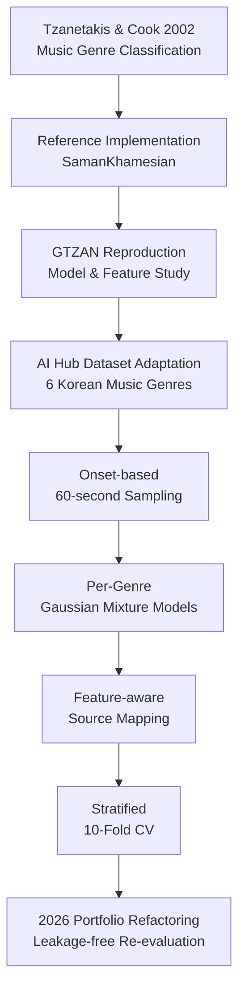
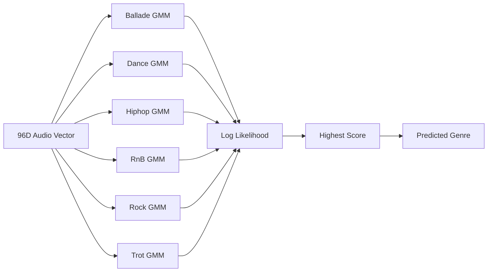
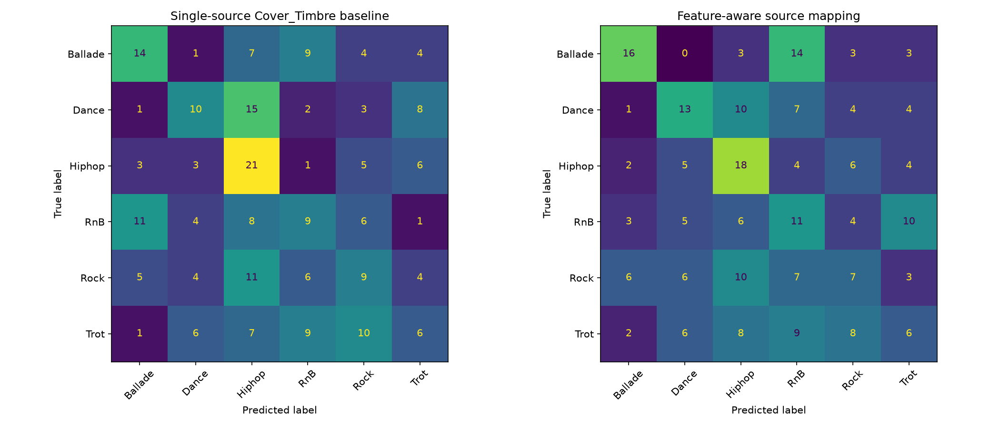

<div align="center">

# Music Genre Classification 🎵

### Feature-aware Audio Representation with Gaussian Mixture Models

**음악 신호를 96차원 handcrafted feature로 표현하고,  
장르별 GMM과 leakage-free 10-fold cross-validation을 통해  
특징별 강조 음원 사용 가설을 실제 데이터에서 검증합니다.**

<br/>

[](https://www.python.org/)
[](https://librosa.org/)
[](https://scikit-learn.org/)

[](https://numpy.org/)


<br/>

[📐 Research Lineage](docs/lineage.md)
&nbsp;·&nbsp;
[▶️ Reproduction Guide](docs/running.md)
&nbsp;·&nbsp;
[📊 Evaluation Result](results/STATUS.md)

</div>

---

## 📌 Overview

**Music Genre Classification**은 Tzanetakis & Cook의 *Musical Genre Classification of Audio Signals*와 공개 reference implementation을 분석한 뒤, 이를 **AI Hub 한국 음악 데이터에 맞게 재설계한 classical machine learning 실험 프로젝트**입니다.

프로젝트에서는 음악을 하나의 end-to-end neural network에 직접 입력하는 대신, 음색·리듬·피치와 관련된 특징을 Librosa로 추출해 **96차원 audio representation**으로 변환하고 각 장르별 Gaussian Mixture Model을 학습합니다.

특히 다음 가설을 실험했습니다.

```text
Single-source Pipeline

Cover_Timbre
      │
      ├─ Timbre Features
      ├─ Rhythm Features
      ├─ Chroma
      └─ Tonnetz


            vs.


Feature-aware Pipeline

Feature Type
      │
      ├─ Timbre      → Cover_Timbre
      ├─ Rhythm      → Cover_Rhythm
      ├─ Chroma      → Cover_Instrument
      └─ Tonnetz     → Cover_Genre
```

2026 Portfolio Refactoring에서는 과거 결과를 그대로 재사용하지 않고, 기존 평가 과정에서 발견된 **cross-validation 이전 scaling으로 인한 data leakage를 제거**한 뒤 2025년 당시 생성한 historical 60-second audio dataset을 다시 평가했습니다.

### Project Info

| 항목 | 내용 |
| --- | --- |
| **프로젝트 유형** | 세종창의학기제 · 5인 팀 프로젝트 내 개인 모델 연구 |
| **수행 기간** | 2025.03.03 – 2025.06.01 |
| **개인 연구 주제** | Handcrafted Audio Feature + GMM 기반 음악 장르 분류 |
| **주요 역할** | 논문 리프로덕션 · Audio Preprocessing · Feature Engineering · GMM · Evaluation |
| **장르** | Ballade · Dance · Hiphop · RnB · Rock · Trot |
| **Audio Processing** | Librosa · SoundFile · NumPy |
| **Machine Learning** | Gaussian Mixture Model · scikit-learn |
| **Evaluation** | Stratified 10-Fold Cross-Validation · Accuracy · Macro F1 |
| **Historical Dataset** | AI Hub 음악 유사성 판별 데이터 기반 60-second sampled audio |

> **Portfolio Refactoring**
>
> 2025년 프로젝트의 연구 의도와 GMM 구조는 유지하면서,
> package/import 구조, sampling-rate 정합성, 96D feature schema,
> deterministic source selection, dataset provenance 및 regression test를 보강했습니다.
>
> 또한 전체 데이터에 먼저 `MinMaxScaler`를 적용한 뒤 cross-validation을 수행하던 기존 평가를 폐기하고,
> **각 fold의 training data에만 scaler를 fit하는 leakage-free evaluation**으로 실제 데이터를 재평가했습니다.
>
> 아래 성능 수치는 모두 이 2026년 재평가 결과이며, 과거 결과를 소급해 사용하지 않습니다.

---

# 🔬 Research Lineage

이 프로젝트는 원 논문을 그대로 복제하는 데서 끝나지 않고, reference implementation을 이해한 뒤 다른 데이터와 실험 목적에 맞게 변경하는 방식으로 발전했습니다.



### 1. Original Paper

Tzanetakis & Cook의 논문에서는 음악 장르 자동 분류를 위해:

- Timbral Texture
- Rhythmic Content
- Pitch Content

의 특징 집합을 제안합니다.

논문의 **19-dimensional vector는 전체 모델의 feature dimension이 아니라 Timbral Texture representation**입니다.

### 2. Reference Implementation

초기 학습 단계에서는 [SamanKhamesian의 공개 구현](https://github.com/SamanKhamesian/Music-Genre-Classification-of-Audio-Signals)을 분석하고 GTZAN dataset으로 실행하며 feature extraction과 classification pipeline을 이해했습니다.

해당 구현은 Librosa를 이용해 MFCC, Chroma, Mel, Tonnetz 등을 포함한 확장된 audio feature representation을 사용합니다.

### 3. My Adaptation

이후 프로젝트 목적에 맞게 다음을 변경했습니다.

```text
GTZAN
    ↓
AI Hub Korean Music Dataset

Single-source Feature Extraction
    ↓
Feature-aware Source Mapping

SVM-centered Reference
    ↓
Per-Genre GMM Classification

Hold-out / Original Evaluation
    ↓
10-Fold Cross-Validation
```

Reference implementation의 classifier와 본 프로젝트의 GMM classifier는 서로 다른 구현입니다.

자세한 출처와 historical / portfolio 경계는 [Research Lineage](docs/lineage.md)에 정리했습니다.

---

# 🏗️ Pipeline

## 1. Historical Audio Preprocessing

프로젝트 당시 팀 공통 데이터는 각 음악에서 **비트 변화가 가장 크게 검출된 시점을 기준으로 60초 구간을 추출**하여 구성했습니다.

```text
Audio
  │
  ▼
Onset Detection
  │
  ▼
Onset Strength
  │
  ▼
Strongest Detected Onset
  │
  ├─ Remaining >= 60 sec
  │       └─ Start → +60 sec
  │
  └─ Remaining < 60 sec
          └─ Last 60 sec
```

현재 실제 성능 평가는 이 과정을 다시 수행한 것이 아니라, **2025년에 생성해 둔 historical 60-second WAV를 그대로 사용**합니다.

Portfolio pipeline에서는 feature extraction representation을 mono 16 kHz로 통일합니다.

---

## 2. 96D Audio Feature Representation

음원은 다음 handcrafted feature의 frame-level 값을 추출한 뒤 coefficient별 mean / standard deviation으로 요약합니다.

| Feature | Dimension | Feature-aware Source |
| --- | ---: | --- |
| Spectral Centroid / Bandwidth / Contrast / Rolloff | 8 | `Cover_Timbre` |
| Onset Strength | 2 | `Cover_Rhythm` |
| Zero Crossing Rate | 2 | `Cover_Timbre` |
| MFCC · 13 coefficients | 26 | `Cover_Timbre` |
| Log Mel · first 10 bands | 20 | `Cover_Timbre` |
| Tempo | 2 | `Cover_Rhythm` |
| Chroma STFT · 12 bins | 24 | `Cover_Instrument` |
| Tonnetz · 6 coordinates | 12 | `Cover_Genre` |
| **Total** | **96** | |

```text
Audio
  │
  ▼
Frame-level Feature Matrix
  │
  ▼
Coefficient-wise
Mean + Standard Deviation
  │
  ▼
96D Song Representation
```

Matrix 전체를 coefficient마다 반복 계산하지 않고 **한 번 계산한 뒤 통계량을 vectorized aggregation**하도록 구성했습니다.

---

# 🚀 Engineering & Experiment Highlights

## 1. 동일 음원에서 모든 특징을 추출하던 구조를 Feature-aware Mapping으로 변경

### Problem

초기 구조에서는 음색, 리듬, pitch-related feature를 모두 같은 하나의 WAV에서 추출했습니다.

하지만 AI Hub dataset에는 같은 곡을 서로 다른 음악적 특성이 강조되도록 변형한 여러 Cover source가 존재합니다.

### Engineering Decision

특징 종류와 source의 역할을 명시적으로 매핑했습니다.

```text
Timbral
├─ Spectral Features
├─ ZCR
├─ MFCC
└─ Mel
        ↓
  Cover_Timbre


Rhythmic
├─ Onset Strength
└─ Tempo
        ↓
  Cover_Rhythm


Chroma
   ↓
Cover_Instrument


Tonnetz
   ↓
Cover_Genre
```

이를 단일 source에서 모든 특징을 추출하는 `Cover_Timbre` baseline과 동일한 song cohort / CV folds에서 비교했습니다.

### Result

Feature-aware 방식의 평균 점수는 소폭 높았습니다.

```text
Accuracy
29.47% → 30.31%
Δ +0.83 percentage points

Macro F1
0.2706 → 0.2902
Δ +0.0196
```

다만 fold 간 variation에 비해 차이가 작기 때문에 **안정적인 성능 개선을 입증했다고 해석하지 않습니다.**

이 실험은 아이디어를 제안하는 것에서 끝나지 않고 동일 조건에서 실제로 검증하고, 결과가 제한적일 경우 그 한계까지 기록한 실험입니다.

---

## 2. Per-Genre Gaussian Mixture Model

하나의 multiclass discriminative classifier 대신 각 장르의 feature distribution을 별도의 GMM으로 학습합니다.



Historical project에서 선정했던 설정을 고정해 사용했습니다.

```text
n_components   = 7
covariance     = diag
max_iter       = 400
init_params    = kmeans
random_state   = 42
```

Portfolio Refactoring에서는 새로운 hyperparameter search를 수행해 결과에 맞춰 모델을 재조정하지 않았습니다.

---

## 3. Cross-Validation 이전 Scaling에서 발생한 Data Leakage 제거

### Problem

기존 구현에서는:

```text
Entire Dataset
      ↓
MinMaxScaler.fit_transform()
      ↓
10-Fold Split
```

순서로 처리했습니다.

이 경우 validation fold의 min/max 정보가 scaling 과정에 포함되기 때문에 cross-validation 결과에 **data leakage**가 발생합니다.

### Engineering Decision

Scaling을 각 fold 내부로 이동했습니다.

```text
10-Fold Split
      │
      ├─ Training Fold
      │      ↓
      │  Scaler.fit()
      │      ↓
      │  transform()
      │
      └─ Validation Fold
             ↓
         transform only
```

두 실험 조건에는 동일한 song cohort와 동일한 fold를 사용합니다.

### Impact

- validation preprocessing information leakage 제거
- baseline / feature-aware 조건의 paired comparison 보장
- 기존 score 대신 새로운 evaluation protocol로 전체 결과 재측정
- validation song IDs와 fold 정보를 결과 metadata로 기록

---

## 4. Class Imbalance를 Deterministic Balanced Cohort로 통제

Historical complete-case dataset의 장르별 개수는 동일하지 않습니다.

```text
Ballade    216
Dance      127
Hiphop      39
RnB         39
Rock        39
Trot       127
```

특정 장르의 데이터 수가 평가 결과를 과도하게 지배하지 않도록 최소 class count에 맞춰 deterministic undersampling을 수행했습니다.

```text
39 songs × 6 genres
        ↓
234 evaluation songs
        ↓
Same 10 CV Folds
        ↓
Baseline / Feature-aware
```

`random_state=42`를 고정하며 선택 결과와 validation song IDs를 결과 metadata에 기록합니다.

---

## 5. Dataset Inventory와 Complete-case Validation

실제 evaluation 전에 historical audio 전체를 먼저 audit했습니다.

```text
5,300 WAV Files
      ↓
590 Song IDs
      ↓
Decode / Duration / Source Validation
      ↓
587 Complete Songs
      ↓
Deterministic Balancing
      ↓
234 Evaluated Songs
```

실제 inventory 결과:

- WAV files: **5,300**
- Discovered songs: **590**
- Required source가 모두 존재하는 songs: **587**
- Excluded songs: **3**
- Decode failures: **0**
- Invalid durations: **0**
- Cross-song decoded-content duplicates: **0**

Audio는 모두 16 kHz mono였으며 약 60초 길이였습니다.

같은 source family에 여러 variant가 존재하는 경우 성능에 따라 선택하지 않고 **dataset-relative path 기준 사전순 첫 파일**을 사용해 실험 재현성을 유지합니다.

---

## 6. Expensive Feature Extraction과 Evaluation 분리

음원 feature extraction은 모델 parameter를 변경할 때마다 반복할 필요가 없는 상대적으로 비싼 작업입니다.

따라서 pipeline을:

```text
Audio
  ↓
Feature Extraction
  ↓
Unscaled 96D Feature Artifact
  ↓
Repeated Model Evaluation
```

으로 분리했습니다.

Feature artifact에는:

- song ID
- label
- feature schema
- source mapping
- source manifest hash
- dataset provenance

를 함께 기록합니다.

단, AI Hub 음원과 feature matrix는 repository에 공개하지 않고 local artifact로 관리합니다.

---

# 📊 Real-data Evaluation

2025년에 생성한 historical 60-second dataset을 2026 Portfolio Refactoring protocol로 다시 평가했습니다.

### Dataset

| Metric | Value |
| --- | ---: |
| Historical WAV files | **5,300** |
| Discovered songs | **590** |
| Complete-case songs | **587** |
| Evaluation cohort | **234** |
| Genres | **6** |
| Songs per genre | **39** |
| Feature dimension | **96D** |
| Cross-validation | **10-Fold** |

### Results

| Condition | Accuracy | Macro F1 |
| --- | ---: | ---: |
| **Single-source `Cover_Timbre`** | **29.47% ± 10.21pp** | **0.2706 ± 0.0938** |
| **Feature-aware Mapping** | **30.31% ± 7.18pp** | **0.2902 ± 0.0654** |
| **Difference** | **+0.83pp** | **+0.0196** |

모든 GMM은 10개 fold에서 정상 수렴했습니다.

<p align="center">
  
</p>

### Interpretation

Feature-aware mapping은 평균 Accuracy와 Macro F1에서 모두 조금 높은 결과를 보였습니다.

그러나:

```text
Accuracy improvement = +0.83pp

Baseline fold std     = 10.21pp
Feature-aware fold std = 7.18pp
```

이므로 해당 차이를 안정적인 성능 향상이라고 주장하기에는 근거가 부족합니다.

따라서 이 프로젝트의 결론은:

> **Feature-aware source mapping이 해당 historical cohort에서 소폭 높은 평균값을 보였지만, 일관된 성능 개선을 입증하지는 못했다.**

입니다.

세부 fold 결과와 provenance는 [Evaluation Result](results/STATUS.md)에서 확인할 수 있습니다.

---

# 🧪 Reproducibility

## Installation

```bash
python -m venv .venv

# Linux / macOS
source .venv/bin/activate

# Windows
.venv\Scripts\activate

python -m pip install -r requirements.txt
python -m pip check
```

Python 3.10 이상을 기준으로 합니다.

## Historical Dataset Audit

Repository에는 AI Hub 음원을 포함하지 않습니다.

2025년에 생성한 60-second historical dataset을 사용할 경우:

```bash
python scripts/inventory_dataset.py \
  --input "<dataset>" \
  --output artifacts/inventory \
  --summary-output results
```

## Feature Extraction

```bash
python scripts/build_features.py \
  --input "<dataset>" \
  --output artifacts/features60 \
  --baseline-source Cover_Timbre \
  --seconds 60
```

## Evaluation

```bash
python scripts/evaluate.py \
  --baseline artifacts/features60/baseline.npz \
  --feature-aware artifacts/features60/feature_aware.npz \
  --inventory artifacts/inventory/dataset_inventory.json \
  --output results
```

상세한 실행 조건은 [Reproduction Guide](docs/running.md)를 참고하세요.

---

# ✅ Regression Tests

```bash
python -m unittest discover -s tests -v
```

Regression test는 다음 invariant를 검증합니다.

- 60-second sampling behavior
- mono / sample-rate normalization
- finite 96D feature schema
- deterministic source selection
- historical duration tolerance
- atomic paired dataset construction
- inventory decode / duplicate checks
- train-fold-only scaling
- shared CV folds and audited cohort consistency

Synthetic test 결과는 실제 음악 분류 성능으로 사용하지 않습니다.

---

# 🛠️ Tech Stack

| Category | Technology |
| --- | --- |
| **Language** | Python |
| **Audio Processing** | Librosa · SoundFile |
| **Numerical Computing** | NumPy |
| **Machine Learning** | scikit-learn |
| **Classifier** | Gaussian Mixture Model |
| **Evaluation** | Stratified K-Fold · Accuracy · Macro F1 · Confusion Matrix |
| **Data Source** | AI Hub 음악 유사성 판별 데이터 |

---

# 📁 Project Structure

```text
music-genre-classification/
│
├── gmm_classifier_feature/
│   ├── audio.py
│   ├── config.py
│   ├── Utilities.py
│   ├── CreateFeatureDataset.py
│   ├── GMM_Classification.py
│   └── EvaluateModel.py
│
├── scripts/
│   ├── sample_audio.py
│   ├── inventory_dataset.py
│   ├── build_features.py
│   └── evaluate.py
│
├── tests/
│   ├── test_pipeline.py
│   ├── test_inventory.py
│   └── test_paired_evaluation.py
│
├── results/
│   ├── STATUS.md
│   ├── dataset_inventory.csv
│   ├── cv_metrics.json
│   ├── fold_metrics.csv
│   ├── feature_source_ablation.csv
│   └── confusion_matrix.png
│
├── docs/
│   ├── lineage.md
│   └── running.md
│
├── requirements.txt
└── README.md
```

---

# ⚠️ Scope & Limitations

이 Repository의 결과는 다음 범위 안에서 해석해야 합니다.

**Historical Dataset**

평가에는 AI Hub 전체 원천 데이터가 아니라 **2025년 프로젝트 당시 생성한 60-second sampled audio**를 사용했습니다.

**Complete-case Evaluation**

`Cover_Timbre`, `Cover_Rhythm`, `Cover_Instrument`, `Cover_Genre`가 모두 존재하는 곡만 paired comparison에 포함됩니다.

**Balanced Evaluation Cohort**

장르별 최소 sample 수에 맞춘 39곡 × 6장르의 균형 집합을 사용하므로 자연 발생 class distribution의 성능을 의미하지 않습니다.

**Source Alignment**

서로 다른 Cover source는 2025년에 독립적으로 sampling되었으며 정확히 같은 timestamp 구간이라고 보장할 수 없습니다. 따라서 결과를 source type 자체의 causal effect로 해석하지 않습니다.

**Feature-aware Result**

Feature-aware mapping은 평균값에서 소폭 높았지만 fold variation에 비해 차이가 작습니다. 안정적인 성능 향상이나 통계적으로 유의한 개선을 주장하지 않습니다.

**Model Scope**

본 프로젝트의 목적은 state-of-the-art genre classifier 구축이 아니라, 논문 기반 feature engineering과 generative classifier를 이해하고 다른 데이터셋에 적용·검증하는 과정에 있습니다.

---

# 👥 Project Context

본 창의학기제에서는 5명의 팀원이 서로 다른 음악 분류·유사도 모델을 연구한 뒤 결과를 비교했습니다.

이 Repository는 그중 **개인적으로 수행한 feature-aware GMM genre-classification experiment**를 다룹니다.

개인 GMM 실험 이후 팀 최종 모델 개선 단계에서는 별도의 SuCo-HRNE 기반 모델에 대해:

- 현재 데이터와 맞지 않는 `repeat & thumbs` 방식 제거 제안
- segment-wise mean / standard deviation feature 적용

에도 참여했습니다.

해당 팀 최종 모델의 성능과 이 Repository의 GMM 결과는 서로 다른 결과이며, 이 README에서는 혼용하지 않습니다.

---

# 📚 References & Attribution

### Paper

George Tzanetakis, Perry Cook  
**Musical Genre Classification of Audio Signals**  
IEEE Transactions on Speech and Audio Processing, 2002  
https://doi.org/10.1109/TSA.2002.800560

### Reference Implementation

SamanKhamesian  
**Music-Genre-Classification-of-Audio-Signals**  
https://github.com/SamanKhamesian/Music-Genre-Classification-of-Audio-Signals

본 프로젝트는 해당 공개 구현을 초기 학습 및 reproduction reference로 분석한 뒤, 데이터셋·classifier·feature-source mapping·evaluation protocol을 프로젝트 목적에 맞게 변경했습니다.

### Dataset

AI Hub  
**음악 유사성 판별 데이터**  
https://www.aihub.or.kr/aihubdata/data/view.do?currMenu=115&topMenu=100&dataSetSn=71544

원천 음원과 local feature artifacts는 Repository에 포함하지 않습니다.

---

<div align="center">

**Paper → Reproduction → Adaptation → Evaluation**

_결과보다 가설과 검증 과정이 설명 가능한 모델을 만드는 데 집중했습니다._

</div>
